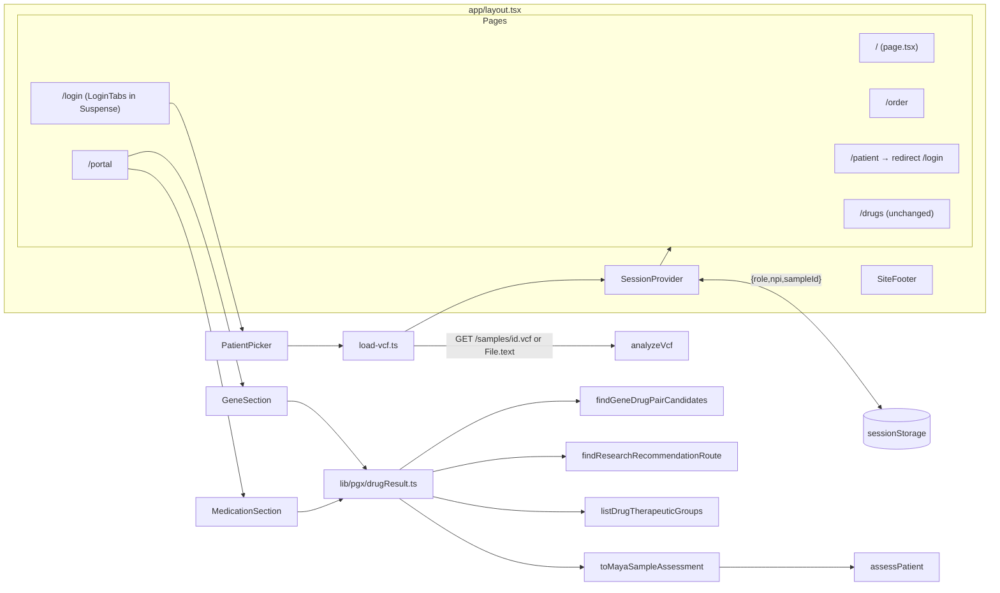

# Design Document

## Overview

The portal replaces `/patient` with a browser-only demo: home, order, demo sign-in, and a results portal. All clinical logic lives in one new pure module, `lib/pgx/drugResult.ts`, built on the existing `analyzeVcf`, `findGeneDrugPairCandidates`, `findResearchRecommendationRoute`, `toMayaSampleAssessment`, `assessPatient`, and `listDrugTherapeuticGroups`. UI components only render what the helper returns.

Key decisions:

- One helper call per drug card. Display status, steering level, guidance line, and clinician rows are all computed in `buildDrugResult`, so the safety rules are testable without React.
- Guidance text (`assessPatient`) is reached only for a bundled sample whose `toMayaSampleAssessment(...).callStatus` is `complete`. Uploads always get the Generic_Prescriber_Line.
- Untested_Guideline_Genes (CYP2D6, HLA-B, CYP2B6, SLC6A4, HTR2A) are always treated as Undetermined, so multi-gene guidelines never resolve from the VCF genes alone.
- Session lives in a React context mounted in the root layout. `sessionStorage` holds only `{ role, npi, sampleId }`, and only for sample sessions.
- No new dependencies. Tailwind v4 utilities, inline SVG icons, relative imports inside `lib/pgx` (vitest has no `@` alias).
- `parseVcf.ts`, `callStarAlleles.ts`, and `data/` stay unchanged.

## Architecture



### Route and file map

| Route / file | Kind | Purpose |
|---|---|---|
| `app/layout.tsx` | server | Wraps children in `SessionProvider`, renders `SiteFooter`. |
| `app/globals.css` | css | Remove the dark-mode override; light background only (Req 18.2). |
| `app/page.tsx` | server | Home: h1, tagline, two cards (`grid sm:grid-cols-2`), "How it works" strip, header link "Clinician sign in" → `/login?role=clinician`. |
| `app/order/page.tsx` | server | Gene list with `GENE_DESCRIPTIONS`, non-empty group labels, steps; renders `OrderForm`. |
| `app/order/OrderForm.tsx` | client | Name, email, checkbox, Submit. `onSubmit` calls `preventDefault()` and sets a `submitted` flag; message in `aria-live="polite"`. No fetch, no storage. |
| `app/login/page.tsx` | server | h1 + `<Suspense><LoginTabs/></Suspense>` (required by `cacheComponents` for `useSearchParams`). |
| `app/login/LoginTabs.tsx` | client | Tablist (roving tabindex, Left/Right switches), Patient tab, Clinician tab with NPI_Gate. |
| `app/portal/page.tsx` | client | Restore or redirect; renders `SessionBanner`, `GeneSection`, `MedicationSection`, "Browse all medications" link. |
| `app/patient/page.tsx` | server | `redirect("/login")` from `next/navigation`. `VcfUpload.tsx` is deleted after `SAMPLE_PATIENTS` moves. |
| `app/_portal/samples.ts` | shared | `SAMPLE_PATIENTS` (moved from `VcfUpload.tsx`), `SampleId`. |
| `app/_portal/load-vcf.ts` | client lib | VCF_Loader. |
| `app/_portal/session-record.ts` | pure | Parse/serialize Session_Record. |
| `app/_portal/session.tsx` | client | `SessionProvider`, `useSession()`. |
| `app/_portal/PatientPicker.tsx` | client | Three account cards + `.vcf` file input, loading and error regions. |
| `app/_portal/StatusChip.tsx` | client | Icon (inline SVG, `aria-hidden`) + visible words. |
| `app/_portal/Diplotype.tsx` | client | Renders a diplotype; CYP2C19 `*38` token gets "*38 (standard)" and a focus/hover tooltip via `aria-describedby`. |
| `app/_portal/SiteFooter.tsx` | server | Demo disclaimer, ClinPGx/CPIC credit linking `catalog.source.usageTermsUrl` from `data/cpic-gene-drug-catalog.v1.json`, NLM sentence. |
| `app/_portal/{SessionBanner,GeneSection,MedicationSection,DrugResultCard}.tsx` | client | Portal sections. |

### Login flow

- `LoginTabs` reads `useSearchParams().get("role") === "clinician"` for the initial tab.
- Patient tab: `<PatientPicker onLoaded={(v) => start("patient", null, v)} />`.
- Clinician tab: NPI input with `<label>`, "Sign in", "Judge demo access" (sets input to `1234567890`). On Sign in, `npi.trim()` empty → show "Enter an NPI number to continue." with `aria-describedby` on the input; otherwise set `acceptedNpi` and render the picker under h2 "Choose a patient". A `// TODO:` comment notes NPI check-digit validation and CMS NPPES lookup as future work.
- `start(role, npi, loaded)` calls `session.start({...})` then `router.push("/portal")`.

### Portal flow

1. If `session` exists, render.
2. Else `restoreFromRecord()`: state `restoring` shows a loading message; `none` → `router.replace("/login")`; `failed` → "We couldn't reload your sample results." with a link to `/login`.
3. Medication section state: `selectedGroupId` (defaults to first non-empty group) and `searchedGroupId | null`. Cards render only when `searchedGroupId === selectedGroupId`; changing the select resets `searchedGroupId` to `null`. Results are `group.drugs.map(d => buildDrugResult({...}))` inside `useMemo`.

## Components and Interfaces

### `lib/pgx/drugResult.ts` (pure)

Imports only `./gene-drug-catalog`, `./research-recommendation-route`, `./sample-assessment`, `./assess-patient`, `./drug-therapeutic-groups` (types), `./types`, and the JSON files `data/cpic-recommendation-routes.v1.json`, `data/allele-definitions.json`, `data/cpic-diplotype-phenotypes.json`. No `fetch`, storage, DOM, or `console`.

```ts
export type DisplayStatus =
  | "Typical"
  | "Your genes may change how this works"
  | "Can't tell from this file"
  | "Needs a clinician-run calculation";
export type SteeringLevel = "typical" | "may-differ" | "talk-to-prescriber";
export type Role = "patient" | "clinician";
export type ResultSource = { kind: "sample"; id: "maya" | "alex" | "sam" } | { kind: "upload" };

export const DISPLAY_STATUSES: readonly DisplayStatus[];
export const STATUS_LEVEL: Readonly<Record<DisplayStatus, SteeringLevel>>;
// Typical→typical, may change→may-differ, can't tell→talk-to-prescriber, calculation→talk-to-prescriber
export const VCF_GENES: readonly string[];        // CYP2C19, CYP2C9, VKORC1, CYP4F2, SLCO1B1, ABCG2, TPMT, NUDT15
export const GENE_DESCRIPTIONS: Readonly<Record<string, string>>; // 8 VCF genes + CYP2D6
export const GENERIC_PRESCRIBER_LINE: string;
export const TYPICAL_LIMIT_LINE: string;
export const ROUTE_NOTES: Readonly<Record<NonSourceRowStatus, string>>; // Req 14.6 table verbatim

export function isIndeterminateCall(call: DiplotypeCall): boolean;
export function geneStatus(call: DiplotypeCall): DisplayStatus;
export function untestedGuidelineGenes(guideline: string): string[];
export function relevantGenes(drug: string, guideline: string): string[];
export function unreadGeneLine(genes: string[]): string | null;
export function buildGeneCards(calls: DiplotypeCall[], role: Role): GeneCard[];
export function buildDrugResult(input: DrugResultInput): DrugResult;

export interface DrugResultInput {
  drug: DrugResearchEntry;        // from listDrugTherapeuticGroups()
  role: Role;
  source: ResultSource;
  parsed: ParsedVcf;
  calls: DiplotypeCall[];
}
```

Draft Gene_Descriptions (no response, safety, or dosing claims; checked against the banned substrings):

| Gene | Description |
|---|---|
| CYP2C19, CYP2C9, CYP2D6 | "Makes a liver enzyme that helps break down some medicines." |
| VKORC1 | "Makes a protein your body uses to help blood clot." |
| CYP4F2 | "Makes an enzyme that helps your body use vitamin K." |
| SLCO1B1 | "Makes a pump that moves some medicines into the liver." |
| ABCG2 | "Makes a pump that moves some medicines out of cells." |
| TPMT, NUDT15 | "Makes an enzyme that helps break down some medicines." |

### Rules inside `drugResult.ts`

Gene classification:

- `isIndeterminateCall(c)`: `c.diplotype === null || c.ambiguous || ["Indeterminate", "No Result", "n/a"].includes(c.phenotype ?? "")`.
- `geneStatus(c)`: Indeterminate → "Can't tell from this file"; else `phenotype === null` → "Needs a clinician-run calculation"; else Normal_Phenotype → "Typical"; else "Your genes may change how this works".
- Patient phenotype text: CYP2D6 → "CYP2D6 cannot be determined from this file."; Undetermined or untested → "We can't tell this gene from this file."; null phenotype with a diplotype → "This gene has no result group. Clinicians use it in a calculation."; otherwise the phenotype string.

Relevant genes (Req 11):

- `untestedGuidelineGenes(title)`: split on `/,\s*(?:and\s+)?|\s+and\s+/`, keep tokens matching `/^[A-Z][A-Z0-9]*(?:-[A-Z0-9]+)?$/` (drops "Statins", "NSAIDs", "Tricyclic Antidepressants"), drop VCF_Genes, keep title order. Sertraline → `[CYP2D6, CYP2B6, SLC6A4, HTR2A]`; phenytoin → `[HLA-B]`.
- `relevantGenes(drug, guideline)`: distinct `findGeneDrugPairCandidates(drug).map(p => p.gene)` sorted alphabetically, then `untestedGuidelineGenes(guideline)`.
- A Relevant_Gene is Undetermined when it is untested, or `calls.filter(c => c.gene === gene).length !== 1`, or that call is Indeterminate, or its phenotype is null.
- `unreadGeneLine(untested)`: `null` for none; otherwise "This medication also depends on {list}, which can't be read from this file." with list = `A` / `A and B` / `A, B, …, and Z`.

Research routes (computed in both roles; exposed only to clinicians):

- `populations` = distinct `population` values of `routes.filter(r => r.drug === drug.drug)` in data order; `[null]` when empty.
- One `findResearchRecommendationRoute({ drug: drug.drug, population, calls, evidence })` call per population.
- `evidence` = for each VCF_Gene `{ gene, genomeBuild: "GRCh38", coverage: "complete", quality: "pass", callerVersion: alleleDefinitions.source.tag, phenotypeTableVersion: phenotypeTable.retrievedAt }` when `source.kind === "sample"` and `toMayaSampleAssessment(parsed, calls).callStatus === "complete"`; otherwise `[]`.

Status precedence (first match wins):

1. Any route result has status `guideline_algorithm_required` → "Needs a clinician-run calculation" (warfarin).
2. Zero Relevant_Genes, or any Relevant_Gene Undetermined → "Can't tell from this file".
3. Any Relevant_Gene phenotype not "Normal Metabolizer"/"Normal Function" → "Your genes may change how this works".
4. Otherwise → "Typical".

`level = STATUS_LEVEL[status]`.

Guidance line:

- If `source.kind === "sample"` and `drug.drug === "clopidogrel"`: `input = toMayaSampleAssessment(parsed, calls)` (already sets drug `clopidogrel`, context `acs_pci`). If `input.callStatus === "complete"`, call `assessPatient(input)`.
- `matched` → `guidanceLine = patientText`, `conditionLabel = "For heart attack or heart stent care (ACS/PCI)"`, `guidelineUrl` from the assessment, `reviewNote = "Demo wording awaits qualified clinical review."` when `humanClinicalReview` is false.
- Any other path (upload, other drug, incomplete call, non-matched) → `GENERIC_PRESCRIBER_LINE`, `conditionLabel = reviewNote = null`, `guidelineUrl = drug.guidelineUrl`.
- `typicalLimitLine = TYPICAL_LIMIT_LINE` only when status is "Typical".

Note: `toMayaSampleAssessment` is reused unchanged for all three bundled samples. Its check is CYP2C19-only, which is the only gene the guidance snapshot covers.

### Session (`app/_portal/session.tsx`, `session-record.ts`)

```ts
type SessionSource = { kind: "sample"; id: SampleId } | { kind: "upload"; fileName: string };
interface Session {
  role: "patient" | "clinician";
  npi?: string;              // clinician only
  patientName: string;
  source: SessionSource;
  parsed: ParsedVcf;
  calls: DiplotypeCall[];
}
type RestoreState = "idle" | "restoring" | "ready" | "none" | "failed";

interface SessionContextValue {
  session: Session | null;
  restore: RestoreState;
  start(session: Session): void;
  restoreFromRecord(): Promise<void>;
  signOut(): void;           // clears state, removes record; caller does router.push("/")
}
```

- `start`: sets state. Sample → `sessionStorage.setItem(KEY, JSON.stringify({ role, npi: npi ?? null, sampleId }))`. Upload → `removeItem(KEY)`.
- `KEY = "karyanomics.session.v1"`.
- `parseSessionRecord(raw: string | null): SessionRecord | null` (pure): returns null for missing, bad JSON, non-object, role not `patient`/`clinician`, unknown `sampleId`, or clinician with non-string or blank npi. Returns a fresh `{ role, npi, sampleId }` (patient npi normalized to `null`).
- `restoreFromRecord`: `parseSessionRecord` null → `removeItem(KEY)`, `restore = "none"`. Otherwise `restore = "restoring"`, `loadSample(sampleId)`; ok → `start` with restored role/npi; failure → `restore = "failed"` (record kept so a refresh can retry).
- `patientName`: sample → display name; upload → `parsed.sampleId?.trim() || file.name`.

### VCF_Loader (`app/_portal/load-vcf.ts`)

```ts
type Loaded = { source: SessionSource; patientName: string; parsed: ParsedVcf; calls: DiplotypeCall[] };
type LoadResult = { ok: true; value: Loaded } | { ok: false; message: string };
export function loadSample(id: SampleId, fetchImpl?: typeof fetch): Promise<LoadResult>;
export function loadUpload(file: File): Promise<LoadResult>;
export function checkParsed(parsed: ParsedVcf): string | null;
```

- `loadSample`: `GET /samples/{id}.vcf`; non-OK or throw → "We couldn't load the sample patient {name}. Please try again."
- `loadUpload`: `file.size > 30_000_000` → "This demo accepts VCF files up to 30 MB."; `file.text()` throws → "We couldn't read that file. Please check it is a plain-text .vcf file."
- Both run `analyzeVcf(text)` then `checkParsed`: build not GRCh38 → message of the `build_not_grch38`/`build_unknown` warning; `sampleCount !== 1` → message of the `multiple_samples`/`no_samples` warning.
- `PatientPicker` disables all controls while loading, shows the loading text in `aria-live="polite"`, and errors in `role="alert"`.

## Data Models

```ts
interface PatientGeneLine { gene: string; phenotypeText: string }
interface ClinicianGeneLine extends PatientGeneLine { diplotype: string | null; activityScore: string | null }

type RouteRow =
  | { kind: "source_row"; population: string; classification: string;
      recommendationId: number; guidelineVersion: number; reviewNote: "Clinical review not complete" }
  | { kind: "note"; population: string | null; status: NonSourceRowStatus; note: string };

interface PatientDrugResult {
  role: "patient";
  drug: string; genericName: string; brandNames: string[];  // UI shows "No current U.S. brand name listed" when empty
  status: DisplayStatus; level: SteeringLevel;
  genes: PatientGeneLine[];        // Relevant_Gene order
  guidanceLine: string;
  conditionLabel: string | null;
  reviewNote: string | null;
  typicalLimitLine: string | null;
  unreadGeneLine: string | null;
  guidelineUrl: string;
}
interface ClinicianDrugResult extends Omit<PatientDrugResult, "role" | "genes"> {
  role: "clinician";
  genes: ClinicianGeneLine[];
  routeRows: RouteRow[];           // one per population, in population order
}
type DrugResult = PatientDrugResult | ClinicianDrugResult;

interface GeneCard {
  gene: string; description: string;
  status: DisplayStatus; level: SteeringLevel; phenotypeText: string;
  clinician?: { diplotype: string | null; activityScore: string | null; phaseAssumed: boolean; note?: string };
}

interface SessionRecord { role: "patient" | "clinician"; npi: string | null; sampleId: "maya" | "alex" | "sam" }
```

The patient shape has no diplotype, activity score, ambiguous flag, classification, recommendation ID, guideline version, or route note fields, so Req 15.1 holds by type and is also checked at runtime.

UI tokens: page `bg-white`, text `text-slate-800`, accent `teal-700` (#0f766e, about 5.5:1 on white) for primary buttons, links, and selected tab; cards `rounded-xl border border-slate-200`; focus `focus-visible:ring-2 ring-teal-700 ring-offset-2`. Status chips: check (Typical, green-800 on green-50), alert triangle (may change, amber-900 on amber-50), question circle (can't tell, slate-800 on slate-100), calculator (calculation, indigo-900 on indigo-50). Icons are `aria-hidden="true"`; the words always show.

## Correctness Properties

*A property is a characteristic or behavior that should hold true across all valid executions of a system-essentially, a formal statement about what the system should do. Properties serve as the bridge between human-readable specifications and machine-verifiable correctness guarantees.*

Inputs below range over: every drug in every Therapeutic_Group; both roles; source `sample` (each id) or `upload`; `parsed` from one of the three sample VCFs; and `calls` that are either a sample Caller_Output, a sample Caller_Output with random edits, or a generated `DiplotypeCall[]` (genes from VCF_Genes plus CYP2D6/HLA-B, nullable diplotype, phenotype from the CPIC table terms plus "Indeterminate", "No Result", "n/a", or null, random `ambiguous`, nullable activity score, duplicates and gaps allowed).

### Property 1: Every drug gets exactly one of four statuses, without throwing

For any valid input, `buildDrugResult(input)` returns without throwing and `result.status` is one of the four `DISPLAY_STATUSES`.

**Validates: Requirements 12.1, 12.14, 22.7**

### Property 2: Steering level always matches the status

For any valid input, `result.level === STATUS_LEVEL[result.status]`, where `STATUS_LEVEL` maps "Typical" → `typical`, "Your genes may change how this works" → `may-differ`, and both "Can't tell from this file" and "Needs a clinician-run calculation" → `talk-to-prescriber`.

**Validates: Requirements 12.7, 12.8, 22.6**

### Property 3: Patient output is free of clinician detail and dosing words

For any Sample_Patient analysis and any drug, the patient-role result has none of the keys `diplotype`, `activityScore`, `ambiguous`, `classification`, `recommendationId`, `guidelineVersion`, `routeRows`, and every string reachable in it (recursive walk) excludes "stop", "dose", "mg", and every CPIC_Classification value in `data/cpic-recommendation-routes.v1.json`, compared case-insensitively.

**Validates: Requirements 15.1, 15.3, 15.4, 22.8**

### Property 4: Determinism

For any valid input, `buildDrugResult(input)` deep-equals `buildDrugResult(structuredClone(input))`.

**Validates: Requirements 12.13, 11.1**

### Property 5: An undetermined relevant gene forces "Can't tell from this file"

For any call list and any drug whose Route_Status is not `guideline_algorithm_required`: (a) replacing every call for any one Relevant_Gene with a single Indeterminate call (`diplotype: null`, `phenotype: "Indeterminate"`), removing it, or duplicating it yields status "Can't tell from this file"; and (b) when the drug's guideline names Untested_Guideline_Genes, the status is "Can't tell from this file" for every call list and `unreadGeneLine` names every such gene in title order.

**Validates: Requirements 11.4, 11.5, 12.3, 12.6, 22.9**

### Property 6: Uploads never receive assessPatient text

For any drug, role, and call list with `source.kind === "upload"` (including the unmodified Maya Caller_Output), `guidanceLine === GENERIC_PRESCRIBER_LINE`, `conditionLabel === null`, and `reviewNote === null`.

**Validates: Requirements 13.6, 13.7, 22.5**

## Error Handling

- VCF_Loader returns `{ ok: false, message }` instead of throwing; `PatientPicker` shows the message in `role="alert"` and creates no Session. Messages are the fixed strings in Req 6.4–6.7; build and sample-count messages come from the parser's own warnings.
- `buildDrugResult` never throws: missing, duplicate, or odd calls become Undetermined, and every router status maps to a Route_Note. `listDrugTherapeuticGroups()` can throw on bad data, but data is frozen and covered by existing tests.
- Bad `sessionStorage` content is deleted and treated as "no session" (redirect to `/login`). A failed sample reload shows "We couldn't reload your sample results." with a `/login` link.
- `sessionStorage` access is wrapped in `try/catch` (private mode can throw); failures fall back to in-memory only.
- No `console` calls anywhere in the feature, so errors never echo VCF text, calls, or NPI values.

## Testing Strategy

Vitest (`npm test`, node environment, files in `tests/`). Tests read `public/samples/{maya,alex,sam}.vcf` with `readFileSync` and run `analyzeVcf`, matching `tests/sample-assessment.test.ts`. All lib imports are relative.

Example tests (`tests/drugResult.test.ts`):

- Maya + clopidogrel (patient, sample): "Your genes may change how this works", guidance line equals the Poor Metabolizer `patientText` in `data/patient-guidance.v1.json`, condition label and review note present.
- Maya VCF as upload + clopidogrel: Generic_Prescriber_Line.
- Sam + simvastatin: "Your genes may change how this works", SLCO1B1 phenotype text "Decreased Function". Alex + simvastatin: "Typical" with `typicalLimitLine`.
- Each sample + warfarin: "Needs a clinician-run calculation"; clinician result has one note row with `population: null`.
- Each sample + amitriptyline: "Can't tell from this file" and "This medication also depends on CYP2D6, which can't be read from this file." Sertraline names "CYP2D6, CYP2B6, SLC6A4, and HTR2A"; phenytoin names "HLA-B".
- `STATUS_LEVEL` table and `ROUTE_NOTES` table equality; `geneStatus` one case per branch (Req 12.9–12.12).
- Maya clinician clopidogrel: three route rows (CVI ACS PCI, CVI non-ACS non-PCI, NVI) in data order; the same text as upload yields `unverified_gene_call` notes.
- `buildGeneCards`: nine cards in Caller_Output order, VKORC1 null-phenotype text, CYP2D6 line, clinician fields only for clinician role. `*38` token helper: labels CYP2C19 `*38` only, not `*138` or other genes.

Session and loader tests (`tests/portal-session.test.ts`): `parseSessionRecord` rejects each invalid case in Req 7.6 and accepts valid patient/clinician records; `checkParsed` returns the parser message for a GRCh37 header and a two-sample header; `loadUpload` size and read-failure messages; `loadSample` with a mocked failing `fetch`.

Property tests (`tests/drugResult.property.test.ts`) use fast-check (already a dev dependency). Each property is one `fc.assert(fc.property(...), { numRuns: 100 })` (at least 100 runs) and carries a tag comment:

```ts
// Feature: portal-frontend, Property 1: Every drug gets exactly one of four statuses, without throwing
```

Manual checks before demo: 375px layout on every page, keyboard pass through tabs/forms/select/tooltip, and `npm run build`. Full WCAG validation needs manual testing with assistive technology; this design only picks tokens that meet the stated contrast ratios.
